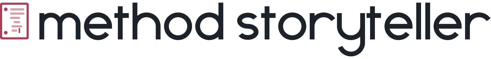
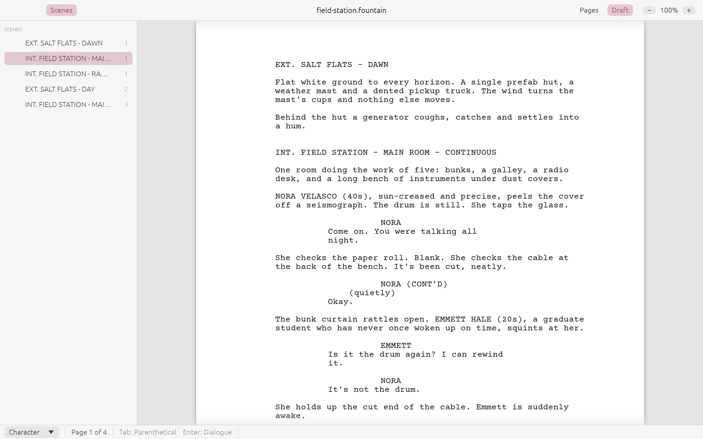
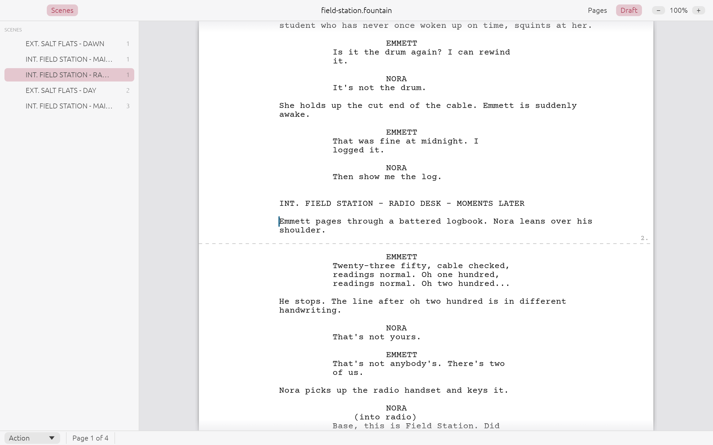
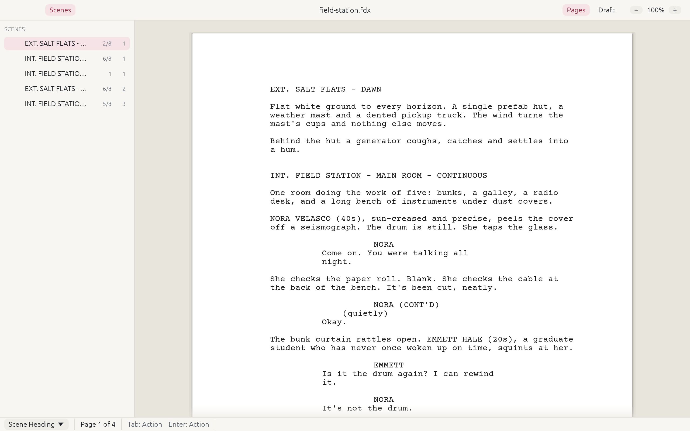
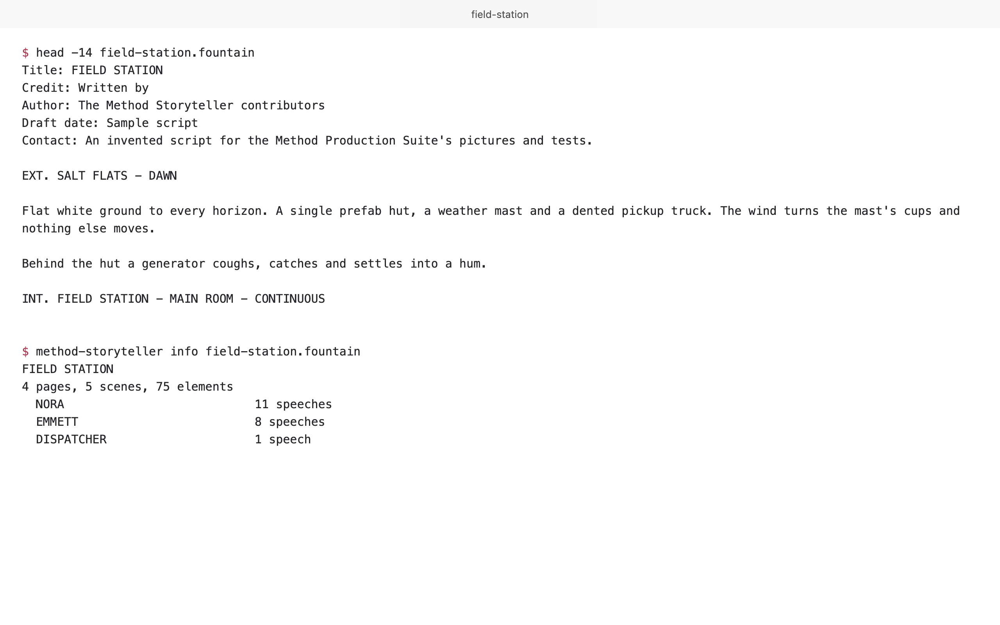

<h1>
  <picture>
    <source media="(prefers-color-scheme: dark)" srcset="docs/brand/wordmark-dark.svg">
    
  </picture>
</h1>

An open-source screenwriting app: free, native on macOS, Windows and Linux (built from source for
now; installers are coming), and your script is an open file you own (Open Screenplay Format by
default, Fountain one choice away).

<picture>
  <source media="(prefers-color-scheme: dark)" srcset="assets/screens/hero-dark.png">
  
</picture>

- **Write without thinking about formatting.** Tab and Enter move between scene heading, action,
  character, parenthetical, dialogue and transition the way screenwriting apps have always worked.
  Character, location and time-of-day autocomplete.
- **Industry pagination.** Courier Prime 12 pt, standard margins, 54 lines a page, `(MORE)` and
  `(CONT'D)` at page breaks, scene headings that never strand at the bottom of a page.
- **Open formats, your choice.** New scripts are Open Screenplay Format (structured XML that keeps
  production detail); Fountain (plain text, diff-friendly) is fully supported and one choice away
  (File > Save New Scripts as…). Opens and saves `.fdx` and `.fadein`; exports PDF.
- **Title page, scene navigator and scene numbers.**
- **Scriptable.** Every action is a named command, every widget has an automation id, and a
  JSON-lines control channel drives the app or a headless engine.

<picture>
  <source media="(prefers-color-scheme: dark)" srcset="assets/screens/page-dark.png">
  
</picture>

<picture>
  <source media="(prefers-color-scheme: dark)" srcset="assets/screens/import-dark.png">
  
</picture>

## Yours to keep

<picture>
  <source media="(prefers-color-scheme: dark)" srcset="assets/screens/file-dark.png">
  
</picture>


- Free, and open source under MIT OR Apache-2.0.
- No account, and it works offline.
- Your script is an Open Screenplay Format file: open, structured XML that keeps production
  detail. Prefer plain text? Choose [Fountain](https://fountain.io/syntax) (File > Save New
  Scripts as Fountain), which any text editor opens, now and in 20 years.

## Status

Status: in development. See [docs/spec.md](docs/spec.md) for what is in and out, and
[docs/architecture.md](docs/architecture.md) for how it fits together.

| Platform | Built | Signed | Tested |
| --- | --- | --- | --- |
| macOS (Apple silicon) | From source | No | CI tests; app checked by hand |
| Windows | From source | No | CI tests |
| Linux | From source | No | CI tests |

There are no installers yet. Also not there yet: printing, revision mode, side-by-side editing of
dual dialogue, and formatting markup still shows as typed in the editor.

## Run it

```bash
cargo run --release -p method-storyteller -- path/to/script.fountain
```

The command line tool `method-storyteller` converts, paginates and exports without a window
(the GUI binary is `method-storyteller-app`):

```bash
cargo run -p storyteller-cli -- pdf script.fountain script.pdf
cargo run -p storyteller-cli -- convert script.fdx script.fountain
cargo run -p storyteller-cli -- paginate script.fountain --text
```

The CLI used to be called `mst`. That name still works as an alias (it prints a one-line note on
stderr) and will be removed in a future release.

## Keyboard

| Key | Does |
| --- | --- |
| Enter | End the element and start the next one (Scene heading → Action, Character → Dialogue, Dialogue → Action …) |
| Enter on an empty element | Open the element picker: S, A, C, P, D, T, H … or the arrows |
| Tab | On an empty element, change its type (Action → Character, Character → Transition …); after text, start the next one (a parenthetical after a cue or a speech) |
| ⌘1 … ⌘7 | Start a Scene heading, Action, Character, Parenthetical, Dialogue, Transition or Shot |
| ⌘⌥1 … ⌘⌥7 (Ctrl+Shift on Windows and Linux) | Change the current element to that type |
| Shift-Enter | Line break inside an action or dialogue paragraph |
| Backspace at the start | Join with the previous element |
| ⌘⌥G (Ctrl+Shift+G on Windows and Linux) | Go to a scene (by its number) or a page |
| ⌘F, then Enter / Shift-Enter (⌘G / ⇧⌘G; F3 / Shift+F3 on Windows and Linux) | Find, next and previous; the find bar also replaces one match or all (one Undo) |
| ⌘; | Spelling: step through words not in the dictionary, with suggestions; Change, Ignore (for this session) or Learn (yours, in every script). Misspelled words are underlined as you type (View > Check Spelling While Typing) |

The status bar always shows what Tab and Enter will do next.

(Ctrl instead of ⌘ on Windows and Linux.)

## Automation

```bash
cargo run -p method-storyteller -- script.fountain --control 9876
```

then send JSON lines to `127.0.0.1:9876`; see [docs/control-protocol.md](docs/control-protocol.md).
`method-storyteller serve --control 9876` runs the same protocol headless.

## Development

`cargo xtask ci` runs every gate: `cargo fmt --check`, `cargo clippy --workspace --all-targets
-- -D warnings`, `cargo test --workspace`, the crate layering check and the asset attribution
check. Read [AGENTS.md](AGENTS.md) before contributing, and [docs/BRAND.md](docs/BRAND.md) before
writing anything a person will read. Pagination changes are reviewed through
the golden files in `crates/core/tests/golden/` (`UPDATE_GOLDEN=1 cargo test -p storyteller-core`
regenerates them).

`cargo xtask screens` retakes every picture above from the invented script in
[examples/field-station.osf](examples/field-station.osf), in light and dark, with the
same pixels every run. The app is drawn offscreen (nothing opens on screen); the terminal picture
needs Chrome. It is a release step rather than a CI gate.

Method Storyteller builds on [craft-libs](https://github.com/storytold/craft-libs) (PDF writing,
atomic saves, settings, macOS quit) and follows the conventions of the storytold Craft apps.

## Licence

Dual-licensed under [MIT](LICENSE-MIT) or [Apache-2.0](LICENSE-APACHE), at your option.
Copyright (c) 2026 Method Production Suite Team and the Method Storyteller contributors.
Courier Prime is under the SIL Open Font License 1.1; see [ATTRIBUTION.md](ATTRIBUTION.md) and
[NOTICE](NOTICE).

Part of the [Method Production Suite](https://methodproduction.com).

Final Draft and Fade In are trademarks of their owners. Method Storyteller is not affiliated with
or endorsed by either; `.fdx` and `.fadein` support is built from publicly known file structures
and published example documents.
